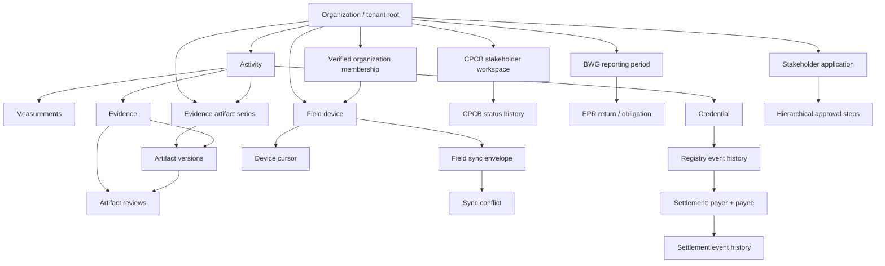

# RupayKg tenant-isolation target model — draft for review

**Status:** Proposed architecture; NOT approved for implementation  
**Baseline:** Production schema/source review 2026-11-01  
**Purpose:** turn the ownership inventory and integrity findings into a testable target model without prematurely applying RLS.

## 1. Non-negotiable principles

1. Organization is the tenant root for organization-owned operational data.
2. Every tenant-owned child must have a database-verifiable ownership path to exactly one organization.
3. Tenant ownership is immutable after record creation unless a dedicated, audited transfer workflow exists.
4. Shared reference data (geography, statutory catalogs, methodology versions, authoritative government snapshots) is platform-managed and read-only to tenant runtime roles.
5. Identity-private data is not made visible merely because the identity belongs to an organization.
6. Cross-organization records are explicit multi-party objects, not exceptions hidden inside a single tenant_id.
7. Platform-control workflows are separate privileged operations, not a general RLS bypass.
8. RLS is a final enforcement layer, not a substitute for correct FKs, application authorization or workflow semantics.

## 2. Logical ownership graph

This is a logical view, not a claim that all arrows are currently implemented as FKs. Cross-organization relationships require explicit parties and policies:
- Credential: project/activity organization, issuer organization, current owner, and each transfer party are distinct attributes.
- Settlement: payer and payee are distinct tenants; current registry owner must be payer under the existing rule.
- Onboarding: applicant identity, target organization, application geography, approval geography/level and platform reviewer are separate authorization dimensions.

## 3. Target table classes and access policy

| Class | Tables/families | Tenant key / authorization | Runtime access pattern |
|---|---|---|---|
| Direct tenant root | organizations, organization_memberships, organization_geography_scopes, organization statutory profiles/evidence | organization_id; membership and permission | Tenant-scoped read; membership/role writes only through governed operations |
| Tenant operational roots | activities, resource_flows, obligations, BWG profiles/periods, CPCB workspaces, EPR returns | organization_id | Tenant RLS; same-statement tenant predicates; controlled writes |
| Parent-inherited child data | measurements, evidence, carbon calculations, reports, artifact series/versions/reviews, sync records | FK chain to tenant parent; add composite constraints or controlled DB functions | RLS via constrained parent relationship or denormalized immutable tenant key plus composite FK |
| Identity-private | identities, credentials, password credentials, sessions | identity_id; platform authentication | Self-only limited view; secrets never returned through tenant queries |
| Shared reference | geography, source catalogs, EPR schemes, CCTS methodologies, authority crosswalks, government snapshots | platform source/version, no tenant owner | SELECT only for app roles; writes only controlled ingestion/admin path |
| Bilateral | settlements, settlement events | payer_id + payee_id; credential owner | Party-specific read/action functions; do not grant either party blanket access to the other's tenant rows |
| Registry provenance | credentials, registry events | project org + issuer + current holder + from/to parties | Narrow transition functions; immutable append-only event chain |
| Platform control plane | stakeholder review queues, legal verification, reserved-role grants, platform security audit | explicit reviewer role, level/geography, dual-control | Dedicated audited functions/views; no broad tenant-role exception |

## 4. Composite integrity constraints proposed

Implement only after data preflight and schema review, initially on a disposable Neon branch.

1. `activities(id, organization_id)` unique key; evidence series must reference matching activity + organization.
2. `evidence(id, activity_id)` unique key where supported; artifact version must bind series activity and evidence activity.
3. Artifact review must reference the exact `(artifact_version_id, evidence_id)` pair.
4. CPCB workspace `(id, organization_id)` unique key; status history references that exact pair.
5. Stakeholder application `(id, geography_id)` unique key; approval step references the same application geography. Define null geography semantics before migration.
6. Organization membership `(identity_id, organization_id)` unique/eligible key; field device must bind identity and organization through this key and a database check of VERIFIED status at enrollment.
7. Field device `(id, identity_id)` unique key; field sync envelope binds both device and identity through a composite FK. Organization is inherited from immutable device ownership.
8. Activity assignment must bind identity/role to activity organization, or use an explicit scoped external-reviewer grant.
9. Legacy operation sync: confirm active usage. If retained, replace text device reference with FK and bind target entity operations to the device's immutable organization. If unused, deprecate only after evidence-backed usage and retention review.

Do not add a redundant tenant_id to every child merely to make RLS easy. Prefer relational integrity; denormalize only where it simplifies safe policy evaluation and is backed by a composite FK/trigger that prevents drift.

## 5. Database identity and tenant context

A policy must not trust `current_setting('app.organization_id')` or `current_setting('app.identity_id')` alone: any SQL client with the runtime role can set a custom GUC.

The design must bind each database transaction to an actual, unexpired, non-revoked application session and verified membership. Candidate patterns for threat-model review:
- a narrow database context-establishment function that validates the bearer session against the stored session hash and validates membership/role, then records transaction-local context;
- a signed, short-lived actor assertion verified inside the database, with signing-key custody, rotation, replay protection and issuer separation specified;
- dedicated database principals per service only for machine-to-machine workloads, not per human user.

The final mechanism must prove that a caller cannot impersonate another identity or tenant by setting arbitrary GUCs, changing request headers, reusing a pooled connection, or invoking a function out of transaction. Do not choose the mechanism until the security threat model and integration test prove it.

## 6. Database roles

| Principal | Intended permissions | Explicitly prohibited |
|---|---|---|
| Tenant API runtime | Least-privilege DML through tenant policies and narrow domain functions | BYPASSRLS, SUPERUSER, CREATEDB, CREATEROLE, REPLICATION, ownership, role membership, schema CREATE |
| Government inbox worker | Exact queue claim/resolve functions and required reference reads | Tenant business table access, BYPASSRLS, event table direct writes, broad UPDATE, INSERT/DELETE on inbox |
| Platform reviewer service | Specific onboarding/legal review functions and permitted queue projections | General tenant CRUD or unrestricted organization directory |
| Migration owner | DDL during controlled release only | Runtime application use; no credentials in API/worker |
| Audit writer | Append-only event operations, validated actor/tenant context | UPDATE/DELETE of audit history |
| Backup/restore operator | Explicit operational recovery scope | Normal application runtime |

## 7. Cross-tenant workflows

### Registry
- Issue: project activity, verification, evidence, methodology and issuer must agree.
- Transfer: current owner and destination organization must both be explicit; destination must be verified; append event atomically.
- Retire: current owner only; reject open settlements.
- Preserve issuer/project organization even after current ownership changes.

### Settlement
- Payer is the current registry owner under existing database guardrails.
- Payee is a second tenant and must be independently represented.
- Define whether payee must consent before authorization; current route checks both parties' membership but high-risk action permission is checked on payer.
- Each party sees only settlement-specific fields, not the other's general tenant records.
- All state changes and settlement events are atomic and immutable.

### Onboarding
- Applicant can read own application.
- Organization members can read only the application for their organization and allowed fields.
- Local/district/state reviewers see only steps matching authorized geography and level.
- Platform reviewer gets the specific platform stage, not a broad tenant bypass.
- Legal verification evidence and platform decision rationale remain distinct from external statutory approvals.

## 8. RLS rollout order

1. Inventory all 67 live public tables and map each to one class; reconcile schema drift and untracked objects.
2. Repair data integrity constraints and prove no orphan/mismatched records.
3. Finalize principal model, session binding, grants and migration owner separation.
4. Build isolated two-tenant integration fixture and direct-SQL adversarial tests.
5. Apply RLS to one low-risk direct-tenant table in a disposable branch; test table owner, app runtime, worker and admin principals.
6. Extend to direct tenant tables by bounded batches; then parent-inherited tables using verified FK paths.
7. Implement dedicated bilateral/control-plane functions and tests.
8. Test session revocation, tenant switching, pool reuse, forged GUCs, role inheritance, concurrent writes, restore and rollback.
9. Full application regression, performance review, independent security assessment.
10. Separate release proposal and explicit production approval. No production mutation is implied by this draft.

## 9. Release gates

- Target ERD: DRAFT.
- Tenant ownership constraints: NOT IMPLEMENTED.
- Database actor/tenant binding: NOT IMPLEMENTED.
- RLS/policies: NOT IMPLEMENTED.
- Two-tenant adversarial proof: NOT YET RUN.
- Independent security review: NOT DONE.
- Worker/scheduler: OFF.
- Production: HOLD.
- TRL 9: NOT ESTABLISHED.

## 10. Membership-key design correction after live catalog inspection

The production `organization_memberships` table has unique `(identity_id, organization_id, role_id)`, not unique `(identity_id, organization_id)`. A person may hold more than one role in an organization. Therefore **do not add a unique constraint on identity + organization** merely to support a field-device FK.

Preferred field-device binding options:
1. Add `organization_membership_id` to `field_devices` referencing the exact membership row; enforce with a trigger/narrow enrollment operation that the membership identity and organization equal the device identity and organization and status is VERIFIED.
2. Or introduce a dedicated organization-person membership/grant root distinct from role assignments, then attach one or more role grants to that root.

The first option is smaller, but membership revocation must disable or quarantine enrolled devices, and every device/sync operation must verify the referenced membership remains VERIFIED. The second option is more normalized but requires a broader identity/membership migration. Select only after route and lifecycle review.

Also note nullable geography columns: ordinary composite FKs use MATCH SIMPLE behavior when a child key component is NULL. For stakeholder approval/application geography equality, use a null-safe constraint trigger or normalize scope into a non-null sentinel/domain model; do not claim a composite FK alone solves nullable geography.

Production preflight additionally found zero rows with missing field-device identity/organization, missing operation-sync actor/device, field-sync devices without identity/organization, or activity assignments whose non-null role belongs to a different organization. These are current-data checks only; no write integrity guarantee follows.
